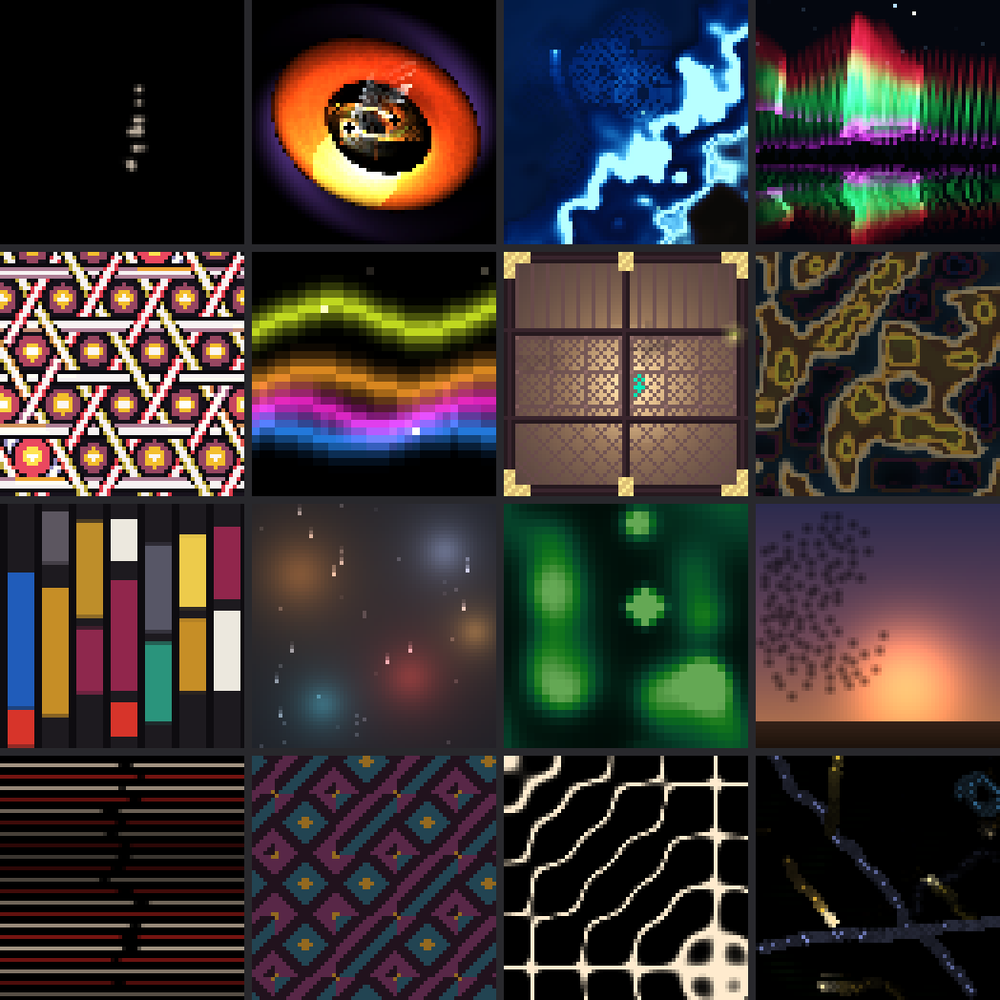
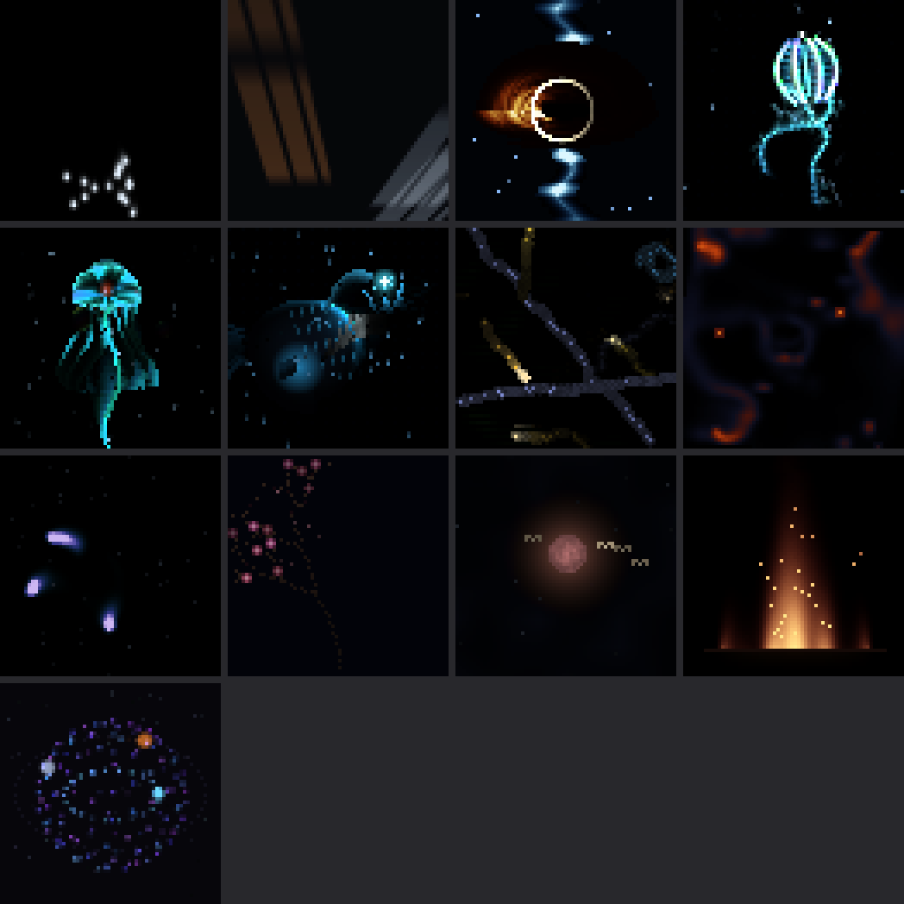
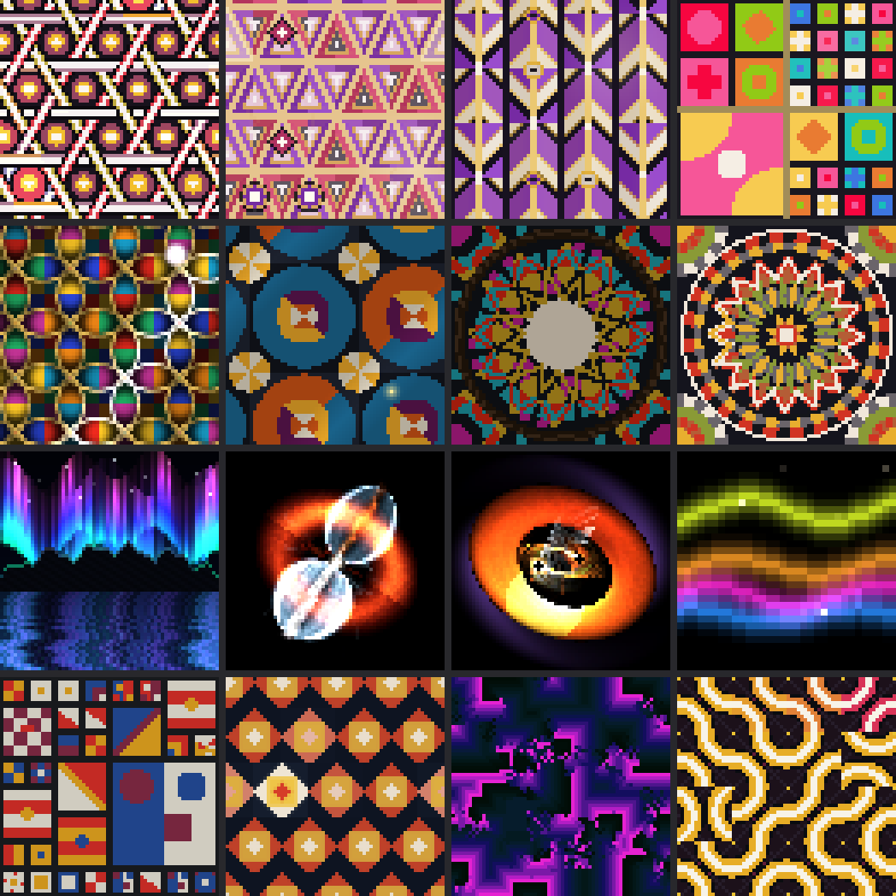

# Open House

The panel as a host: a tour of the whole collection, something bright to read from across the room, and something dim for after everyone has gone home.

A multicart of 3 packs for [Grid Runner](https://github.com/JimWhiteheadUCSC/grid-runner), a generative art player for 64×64 LED panels.

Each pack is its own bank.

## Install

```bash
cd grid-runner/carts
git clone https://github.com/JimWhiteheadUCSC/open-house.git
```

The keys are laid out as 1234 / QWER / ASDF / ZXCV. Images below are stills from
pieces that move.

## Grand Tour

One strong piece from each of thirteen themed packs, plus one each from Standing Waves, After Dark and Across the Room. Load it first, or show it to a visitor: one bank that shows the range and points to the other packs. It’s the one pack here that’s openly a sampler.



| Key | Piece | Artist | Run | Reacts to |
|---|---|---|---|---|
| 1 | Passerby | Saccade | Saccade | clock |
| 2 | Inspiral | Cinnabar | Gemini no-artists |  |
| 3 | Noctiluca Bay | Mica | Gemini cold prior | clock, sound, button |
| 4 | Revontulet | Tessera | Gemini prior | clock, sound, button |
| Q | Kagome Weave (Triaxial Bamboo Lattice Plate) | Chusen | Gemini full | clock, sound |
| W | Copper Dawn | Retrace | Ember env seed |  |
| E | Mawari-dōrō | Koushi | Gemini no-argument | clock, sound, button |
| R | The Sea Takes Back the Map | Register | Register | clock, weather |
| A | City-Discount (Septet in Eight Chords) | Chusen | Gemini full | clock, sound |
| S | Sodium Rain | Tallow | Ember env seed | clock, weather, sound |
| D | Lichen | Jiffy | Ember prior | clock, sound, button |
| F | Vespers | Dither | Ember no-artists | clock, weather, sound |
| Z | Saccades, After Molnar | Saccade | Saccade | clock |
| X | The Flaw Travels | Weft | Ember cold full | clock |
| C | Sympathetic | Saccade | Saccade | sound |
| V | Wilson Cloud Chamber | Sinter | Gemini cold no-artists | clock, sound, button |

## After Dark

A mix with a job: the panel in a dark room, or next to a bed. Everything here is dim and mostly black, drawn from across the runs. The pieces were chosen by measured brightness first, then by mood.



| Key | Piece | Artist | Run | Reacts to |
|---|---|---|---|---|
| 1 | The Long Fall | Saccade | Saccade |  |
| 2 | Someone Else Going Home | Saccade | Saccade | clock |
| 3 | Gargantua | Tessera | Gemini prior | clock, sound, button |
| 4 | Pleurobrachia | Kento | Gemini cold prior | clock, sound, button |
| Q | The Crown of Atolla | Pytheas | Gemini cold prior | clock, sound, button |
| W | Melanocetus | Tessera | Gemini prior | clock, sound, button |
| E | Wilson Cloud Chamber | Sinter | Gemini cold no-artists | clock, sound, button |
| R | Long Exposure | Latch | Ember cold no-artists | sound |
| A | Catherine Wheel | Bellows | Ember cold no-artists |  |
| S | A Plum Tree, Flowering Out of Season | Retrace | Ember no rain/fire | clock |
| D | Moon Compass | Matiz | Ember no rain/fire | sound |
| F | Banked Fire | Porch | Ember env seed | clock, sound |
| Z | The Second Hand Is a Moon | Solyanka | Ember full | clock, sound |

## Across the Room

The opposite job: a bright room, a party, a hallway. High contrast, big shapes and saturated color that should still read from a distance, chosen from whichever run had them. It’s the least subtle thing here, and that’s the brief.



| Key | Piece | Artist | Run | Reacts to |
|---|---|---|---|---|
| 1 | Kagome Weave (Triaxial Bamboo Lattice Plate) | Chusen | Gemini full | clock, sound |
| 2 | Uroko (The Dragon's Scale) | Kasane | Gemini no-craft | clock, sound, button |
| 3 | Yagasuri (The Arrow's Flight) | Solyanka | Gemini no-craft | clock, sound, button |
| 4 | Komawake (The Divided Square) | Solyanka | Gemini no-craft | clock, sound, button |
| Q | The Seven Treasures | Register | Register | clock, weather, sound |
| W | Plate Four, In Counterchange | Register | Register | clock, weather, sound |
| E | The Object Chamber | Register | Register | clock, weather, sound |
| R | Kaléidoscope Mécanique (Plate 06) | Chusen | Gemini full | clock, sound |
| A | Nordlys over Lysefjord | Solyanka | Gemini cold no-artists | sound |
| S | Kilonova | Barycenter | Gemini no-artists |  |
| D | Inspiral | Cinnabar | Gemini no-artists |  |
| F | Copper Dawn | Retrace | Ember env seed |  |
| Z | Square Symphony (Eight Movements in Color) | Chusen | Gemini full | clock, sound |
| X | Defect on the Kyoto Bolt | Chusen | Gemini full | clock, sound |
| C | Loom of Hours | E-Line | Ember cold prior | clock, sound |
| V | Kumihimo Labyrinth (Braided Truchet Plate) | Chusen | Gemini full | clock, sound |


## What the pieces react to

The "Reacts to" column in each table shows which of these a piece uses. Every
piece still works without them.

- **Clock:** the time, the date, and how light it is outside, worked out from
  local sunrise and sunset. A piece can look different at night or change with
  the seasons.
- **Weather:** the current temperature, cloud cover and rain from
  [Open-Meteo](https://open-meteo.com). Grid Runner defaults to Santa Cruz,
  California, and `--lat` and `--lon` set your own location.
- **Sound:** loudness, bass, mid, treble and beats. Use `--audio arecord
  --audio-device plughw:1,0` for a USB microphone. Without one, pieces hear a
  built-in test signal.
- **Button:** press Enter, or the middle knob on a macro pad, and the piece
  responds. Some also react to holding it.

## About these pieces

These pieces were created using Sides Taken, an autonomous AI artist framework.
Jim Whitehead selected the inspiring artists and hand-crafted the framework, but
the artworks were created autonomously by the AI artists.

Each artist in the tables above is the name an agent chose for itself. Saccade,
Register and Selvedge are single runs. Gemini (Gemini 3.8 Flash) and Ember
(Ember-1) are the two models in a study that gave agents different materials:
`full` had artist dossiers, craft files and an argument step, `no-…` removed one,
`prior` removed all three, and `cold` means an independent one-session start.
Any other label is a follow-up test.

Pieces in this repo cite these artists as influences: Jim Campbell, Mizuki Heitaro, Okazz, Vera Molnár, Verena Loewensberg. Those artists have
no connection to these pieces and haven't endorsed them.

## License

Copyright (c) 2026 Jim Whitehead. All rights reserved. You may use and copy these
pieces for your own personal, non-commercial use. See [LICENSE](LICENSE).
